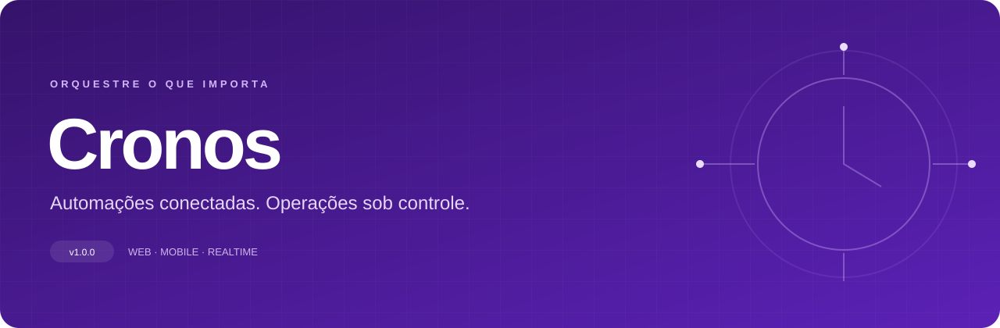
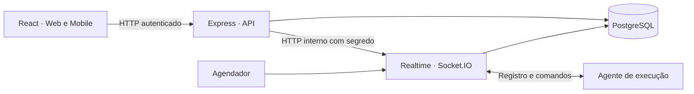

<div align="center">



<br />


**Uma central para cadastrar automações, conectar máquinas, agendar rotinas e acompanhar execuções.**

[Funcionalidades](#funcionalidades) · [Começar](#começar) · [Arquitetura](#arquitetura) · [Testes](#testes) · [Produção](#produção)

</div>

## O projeto

O **Cronos** é um orquestrador desenvolvido para o Projeto Integrador de graduação. A interface reúne a operação das automações; uma API controla os dados e acessos; um serviço em tempo real conversa com os agentes que executam os processos nas máquinas cadastradas.

A identidade usa **roxo `#5B21B6`**, com temas claro e escuro e navegação adaptada para desktop e celular.

## Funcionalidades

| Área | O que você pode fazer |
| --- | --- |
| **Visão geral** | Consultar automações ativas, máquinas conectadas e últimas execuções, com dados do ambiente. |
| **Automações** | Cadastrar, editar, ativar, excluir, pesquisar e disparar uma automação para uma máquina. |
| **Gatilhos** | Programar execuções diárias, semanais ou mensais; pesquisar por automação, máquina, horário ou periodicidade e filtrar por departamento. |
| **Máquinas** | Gerenciar agentes, consultar conexão e gerar ou renovar o segredo de autenticação. |
| **Histórico** | Consultar resultados, duração e erros; filtrar por busca, status, departamento e período, com paginação e atualização periódica. |
| **Usuários** | Gerenciar contas, nome de usuário, perfil, permissões, situação e redefinição administrativa de senha. |
| **Acesso** | Entrar com e-mail ou nome de usuário, exibir senha e escolher manter a sessão; encerramento por inatividade na interface. |

### Uma interface para cada tela

- **Desktop:** menu lateral recolhível, cabeçalho integrado e atalhos para início, tema e perfil.
- **Celular:** navegação no rodapé; Máquinas e Usuários ficam em **Mais**, conforme a permissão.
- **Login:** apresentação da marca acima do formulário no celular, controle de tema e campos preparados para preenchimento por teclado.
- **Preferências:** tema salvo no navegador; filtros e estado do menu separados por conta.
- **Estados da aplicação:** carregamento de módulos preservando a navegação, mensagens de erro e apresentação de listas vazias.

### Como uma execução acontece

1. Cadastre a automação e o caminho do executável na máquina de destino.
2. Cadastre uma máquina e configure seu agente com o nome e o segredo gerado.
3. O agente se conecta ao serviço Socket.IO e autentica o registro.
4. Dispare pela interface ou configure um gatilho.
5. O Cronos registra a execução e envia o comando ao agente.
6. O agente informa o resultado; o histórico é atualizado no PostgreSQL.

> **O agente executa o processo.** A interface web não executa arquivos no navegador. O caminho cadastrado precisa existir na máquina do agente. Este monorepo não inclui um instalador de agente nem executáveis de demonstração. A referência antiga `CronosClient`, que não possuía URL de submódulo configurada, foi removida; o agente deve ser fornecido e configurado separadamente. O teste de fluxo usa um agente simulado.

## Começar

### Pré-requisitos

- **Node.js 22 ou superior** e npm.
- **Docker Engine/Desktop com Docker Compose** para o banco local.
- Portas `3000`, `3001`, `3002` e `5433` disponíveis; `5051` para o pgAdmin.

```bash
git clone https://github.com/gustavoprad0/Cronos.git
cd Cronos
cp .env.example .env
npm ci
npm run docker:up
npm run dev
```

No PowerShell, use `Copy-Item .env.example .env` no lugar de `cp`. No Windows, `start.bat` também inicia o desenvolvimento após a instalação e a criação do banco.

O comando `dev` sincroniza o esquema do banco e inicia os três serviços. Aguarde o PostgreSQL ficar saudável; em seguida, abra **[localhost:3000](http://localhost:3000)**.

| Serviço | Endereço | Uso |
| --- | --- | --- |
| Web | `http://localhost:3000` | Interface do Cronos |
| API | `http://localhost:3001/api` | Endpoints autenticados |
| Saúde da API | `http://localhost:3001/health` | Verificar disponibilidade do serviço |
| Realtime | `http://localhost:3002` | HTTP interno e Socket.IO dos agentes |
| PostgreSQL | `localhost:5433` | Banco da aplicação |
| pgAdmin | `http://localhost:5051` | Administração local do banco |

### Primeiro acesso

Em um **banco recém-criado**, a inicialização cadastra:

```text
E-mail: admin@cronos.com
Senha:  admin123
```

Essas credenciais são de desenvolvimento. Em um banco existente, use a senha atual. Na área de usuários, um administrador pode editar a própria conta, definir um nome de usuário e alterar a senha. A inicialização não recria a conta padrão em um banco que já possui usuários.

A recuperação de acesso orienta o usuário a procurar um administrador. **Não há envio automático de e-mail ou recuperação por código nesta versão.**

### Testar no celular

Com `npm run dev` já em execução, abra outro terminal:

```bash
npm run dev:web -- --host 0.0.0.0 --port 3003
```

No celular conectado à mesma rede, acesse `http://IP_DO_COMPUTADOR:3003`. Libere a porta no firewall se necessário. A interface usa o proxy `/api`, portanto o celular não precisa acessar `localhost:3001`. Encerre esse servidor ao terminar o teste em rede.

### Parar e preservar os dados

```bash
# No terminal do desenvolvimento: Ctrl+C

# Parar os containers, preservando os volumes:
docker compose stop

# Remover os containers, preservando os volumes:
npm run docker:down
```

> `npm run docker:reset` **apaga os volumes e os dados locais** antes de recriar o ambiente. Use somente quando quiser reiniciar o banco do zero.

## Arquitetura



```text
Cronos/
├── apps/
│   ├── web/                  React, Vite, páginas, temas e navegação
│   ├── server/               API Express, autenticação e regras de acesso
│   └── realtime/             Socket.IO, despacho e agendamento
├── packages/shared/          Tipos compartilhados em TypeScript
├── docker/                   Esquema SQL e configuração do pgAdmin
├── scripts/                  Sincronização e testes automatizados
├── docs/assets/              Identidade visual da documentação
├── docker-compose.yml        PostgreSQL e pgAdmin locais
└── .env.example              Configuração de referência
```

**Tecnologias:** React 19, TypeScript, Vite, Express, PostgreSQL 16, Socket.IO, JWT, bcrypt, Font Awesome e SweetAlert2. O monorepo usa **npm workspaces**.

### Regras de acesso e execução

- Senhas são armazenadas com hash bcrypt; a API exige JWT nas rotas de operação.
- A API consulta a conta atual para aplicar desativação e mudanças de permissão a sessões já abertas.
- Gestão de usuários é liberada para administradores e contas com permissão explícita.
- Cada máquina autentica sua conexão com nome e segredo.
- A conclusão de uma execução é aceita apenas do agente responsável, enquanto ela está em andamento.
- As chamadas HTTP internas de consulta, disparo e interrupção exigem um segredo compartilhado entre API e Realtime.
- Gatilhos consideram o horário local do processo Realtime. As regras de antecipação/postergação deslocam sábado e domingo para sexta ou segunda.

## Configuração

Copie `.env.example` para `.env`. O arquivo real fica fora do versionamento.

| Variável | Finalidade |
| --- | --- |
| `PORT` | Porta HTTP da API; padrão `3001`. |
| `REALTIME_PORT` | Porta do serviço Realtime; padrão `3002`. |
| `REALTIME_INTERNAL_SECRET` | Segredo idêntico na API e no Realtime para suas chamadas internas. |
| `REALTIME_HTTP_URL` | Endereço do Realtime visto pela API; padrão `http://localhost:3002`. |
| `DATABASE_URL` | Conexão dos serviços com o PostgreSQL. |
| `POSTGRES_USER`, `POSTGRES_PASSWORD`, `POSTGRES_DB`, `POSTGRES_PORT` | Configuração do banco no Compose. |
| `PGADMIN_PORT`, `PGADMIN_DEFAULT_EMAIL`, `PGADMIN_DEFAULT_PASSWORD` | Acesso ao pgAdmin local. |
| `JWT_SECRET` | Chave de assinatura dos tokens de sessão. |
| `NODE_ENV` | `development` no ambiente local; `production` na implantação. |
| `VITE_API_URL` | URL opcional da API no build web; padrão `/api`. |

Variáveis `VITE_*` são públicas e incorporadas ao build. Configure-as no ambiente do frontend, por exemplo em `apps/web/.env.local`, ou exporte-as antes de compilar. Segredos nunca devem usar esse prefixo.

## Testes

```bash
# Compila os quatro workspaces na ordem correta:
npm run build

# Verifica regras de calendário, sem banco ou serviços:
npm run test:schedule

# Com banco, API e Realtime locais em execução:
npm run test:auth
npm run test:flow
```

| Teste | Cobertura |
| --- | --- |
| `test:auth` | Login pelos dois identificadores, senha incorreta, perfil, alteração e duplicidade de usuário, revogação e desativação durante a sessão. |
| `test:schedule` | Regras semanais e mensais de manutenção, antecipação e postergação de fins de semana. |
| `test:flow` | Máquina e automação temporárias, agente simulado, disparo, conclusão e proteção de execuções encerradas. |

Os testes de integração criam registros temporários e tentam removê-los ao final. Execute-os **apenas no ambiente de desenvolvimento**. Se alterou o administrador inicial, configure `CRONOS_TEST_EMAIL` e `CRONOS_TEST_PASSWORD` no terminal. O teste de autenticação também aceita `CRONOS_TEST_API`; o teste de fluxo usa as portas locais padrão.

Compilar não substitui uma revisão visual em aparelhos reais. Confira login, troca de tema, navegação inferior, tabelas e formulários nas larguras utilizadas pela equipe.

## Produção

O Docker Compose incluído é voltado ao **banco de desenvolvimento**; ele não publica os três serviços da aplicação.

1. Prepare PostgreSQL com backup e configure `DATABASE_URL`.
2. Use valores fortes e próprios para `JWT_SECRET` e `REALTIME_INTERNAL_SECRET`; o segundo deve ser igual na API e no Realtime. Troque as credenciais padrão de todas as contas.
3. Revise o SQL de inicialização antes de executá-lo em produção: o banco vazio recebe o administrador de desenvolvimento indicado acima.
4. Execute `npm ci` e `npm run build`. Inicie a API com `npm start` e o Realtime com `npm run start:realtime`, sob um gerenciador de processos.
5. Sirva `apps/web/dist` em um servidor web com HTTPS e fallback de rotas para `index.html`. Encaminhe `/api` para a API **preservando esse prefixo**.
6. Disponibilize Socket.IO aos agentes autorizados por uma conexão protegida, mantendo os endpoints HTTP internos fora do acesso público.
7. Defina o fuso horário do processo Realtime e confira os horários cadastrados antes de ativar agendamentos.

### Limites atuais

- Não há calendário de feriados, fila distribuída ou garantia de execução única entre múltiplas instâncias do agendador. Use uma instância de Realtime nesta versão.
- A recuperação de senha é administrativa.
- O agente de execução precisa ser instalado e configurado separadamente.
- O repositório não define uma licença de distribuição.

## Comandos de referência

| Comando | Ação |
| --- | --- |
| `npm run dev` | Sincroniza o banco e inicia API, Realtime e Web. |
| `npm run dev:server` | Inicia somente a API em desenvolvimento. |
| `npm run dev:realtime` | Inicia somente o Realtime em desenvolvimento. |
| `npm run dev:web` | Inicia somente o frontend. |
| `npm run db:update` | Aplica o esquema de `docker/init.sql`. |
| `npm run build` | Compila shared, server, realtime e web. |
| `npm run docker:up` | Inicia PostgreSQL e pgAdmin. |
| `npm run docker:logs` | Acompanha logs dos containers. |

---

<div align="center">

**Cronos · Projeto Integrador · v1.0.0**<br />
Uma base para evoluir a automação com visibilidade, organização e controle.

</div>
